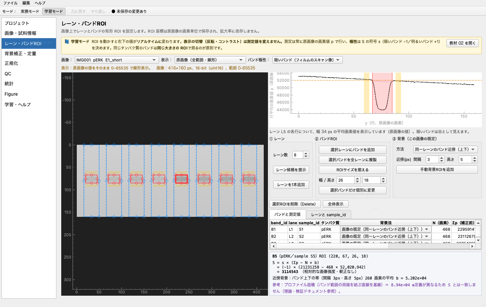

# Western blot 定量ツール（wbtool）

感光フィルムをスキャンした Western blot 画像から、**バンド定量 → 背景補正 → 正規化 → QC → 統計 → Figure** までを
1つのローカル GUI で行う、研究室向けのツールです。学生が一人で解析できるよう、**学習モード**と日本語マニュアルを内蔵しています。

- ImageJ/Fiji の代わりではなく、Western blot に絞った**手順の標準化・解析の記録・教育**のためのツールです。
- 原画像は変更しません。パスと SHA-256 ハッシュで参照し、ROI 座標・設定・判断・操作履歴をすべて保存します。
- 測定値は**較正されていない相対的な画像強度**です。光学密度やタンパク質の絶対量ではありません。



## 動作環境

- macOS（主対象。macOS 15 で確認）。Windows / Linux でも PySide6 が動けば動作する想定です（未検証）。
- Python 3.11 以上（開発は 3.12）

## 環境構築と起動（macOS）

```bash
cd Pjt_WB
# uv を使う場合（推奨）
uv venv --python 3.12 .venv
uv pip install --python .venv/bin/python -e ".[dev]"
# uv が無い場合
python3 -m venv .venv
.venv/bin/pip install -e ".[dev]"

# 起動
.venv/bin/python -m wbtool
# 保存したプロジェクトを指定して起動
.venv/bin/python -m wbtool path/to/project.wbproj.json
```

テストの実行：

```bash
.venv/bin/python -m pytest
```

## 学生向け最短手順

1. `.venv/bin/python -m wbtool` で起動する。
2. ［プロジェクト］→「教材用サンプルを開く」（教材用合成データ。実験データではありません）。
3. ［レーン・バンドROI］で赤い ROI をドラッグし、右下の値が変わることを確かめる。⌘Z で元に戻す。
4. ［QC］→［正規化］→［統計］→［Figure］の順に確認する。
5. 自分のデータでは、［画像・試料情報］で画像を追加し、タンパク質・膜・露光・試料表を入力してから同じ順に進める。

詳しくは [docs/user_guide_ja.md](docs/user_guide_ja.md)（アプリ内の［学習・ヘルプ］からも読めます）。

## 入力形式

| 形式 | 扱い |
|---|---|
| TIFF（8/16-bit グレースケール） | **推奨**。16-bit のまま測定 |
| PNG（8/16-bit） | 可 |
| JPEG | 不可逆圧縮のため警告付きで読み込み |
| RGB カラー | 3 チャンネルが同じなら1チャンネルを使用。違う場合は 0.299R+0.587G+0.114B で変換し、警告 |
| 多ページ TIFF・浮動小数点画像 | 非対応（理由と対処をエラーで表示） |

試料表 CSV：`sample_id, group, bio_rep, tech_rep, notes[, image_id, lane_id]`（例：`examples/synthetic_samples.csv`）

## 計算の定義（要約）

ROI 内の原画像の画素値 p<sub>i</sub>、背景値 b、極性の符号 s（暗いバンド −1、明るいバンド +1）、ROI の画素数 N として

```
S = Σ_i s·(p_i − b) = s·(Σp − N·b)
```

補正前積分値 Σp、背景値 b、N·b、S、N をすべて別々に記録し、**負の値も 0 に丸めません**。
正規化は ① sample_id ごとに S(分子)/S(分母) → ② technical replicate を平均 → ③ Control 群平均で割る（fold）。
詳細は [docs/theory_ja.md](docs/theory_ja.md)。

## 保守的な初期値とその理由

| 項目 | 初期値 | 理由 |
|---|---|---|
| 測定方法 | 矩形 ROI の背景補正積分 | 定義が単純で、Fiji の RawIntDen と照合できる |
| バンド極性 | 暗いバンド | フィルムのスキャン像ではバンドが暗い。表示の反転とは独立に設定 |
| 背景法 | 同一レーンのバンド近傍（上下、間隔 3 px・高さ 5 px） | レーン内の背景の傾きを線形なら打ち消せる。バンドの裾を避けるため間隔を空ける |
| 負の S | 丸めない | 丸めると背景推定の問題が隠れ、平均が偏る |
| レーン検出 | 「候補提示」のみ | 完全自動検出は検証されていないため、必ず人が確認する |
| 飽和判定 | 端値（0 / 最大値）の画素数による「疑い」 | 端値に達しない非線形性は画像からは検出できない |
| 統計の単位 | biological replicate | technical replicate や同じ膜の別露光を独立な n に数えないため |
| 検定 | Welch の t（等分散を仮定しない）／対応 t | 小標本で分散が等しい保証がない。3群以上は未実装として選択不可 |
| エラーバー | SD | ばらつきそのものを示す。SEM と混同しないよう図の説明に明記 |
| 膜間比較 | 補正しない（警告のみ） | 共通参照レーンによる補正は仮定が多く Phase 2 |
| OD 変換 | 行わない | スキャナーとフィルムの較正なしに OD とみなすのは誤り |

## ディレクトリ構成

```
wbtool/
├── app/        GUI（PySide6 + pyqtgraph）。計算は core を呼ぶだけ
├── core/       画像読込・定量・レーン候補・QC・正規化・統計・作図・出力・合成データ（GUI 非依存）
├── models/     プロジェクトのデータモデル（JSON 保存）
└── resources/lessons/  学習モードの教材 7 ページ
examples/       教材用合成画像・試料表 CSV・正解値（make_examples.py で再生成）
tests/          pytest（合成画像による既知解テスト、GUI 結合テスト）
docs/           user_guide_ja / theory_ja / protocol_ja / validation_imagej
```

## 開発状況

- MVP（仕様の C1〜C7、D、E）を実装済み。実装済み／未実装の一覧は [TODO.md](TODO.md)、計画は [IMPLEMENTATION_PLAN.md](IMPLEMENTATION_PLAN.md)。
- 実画像での Fiji/ImageJ との照合はまだ行っていません（手順は [docs/validation_imagej.md](docs/validation_imagej.md)）。
  合成画像では、既知の画素値から計算した値と一致することを自動テストで確認しています。

## 科学的な注意

- スキャナーの非線形性やフィルムの露光飽和は、画像処理では修復できません。
- 画素値の分布だけでは、信号とタンパク質量の比例関係（線形範囲）は証明できません。希釈系列や複数露光で確認してください。
- 異なる膜・露光・実験日の生の積分値は、そのまま比較できません。
