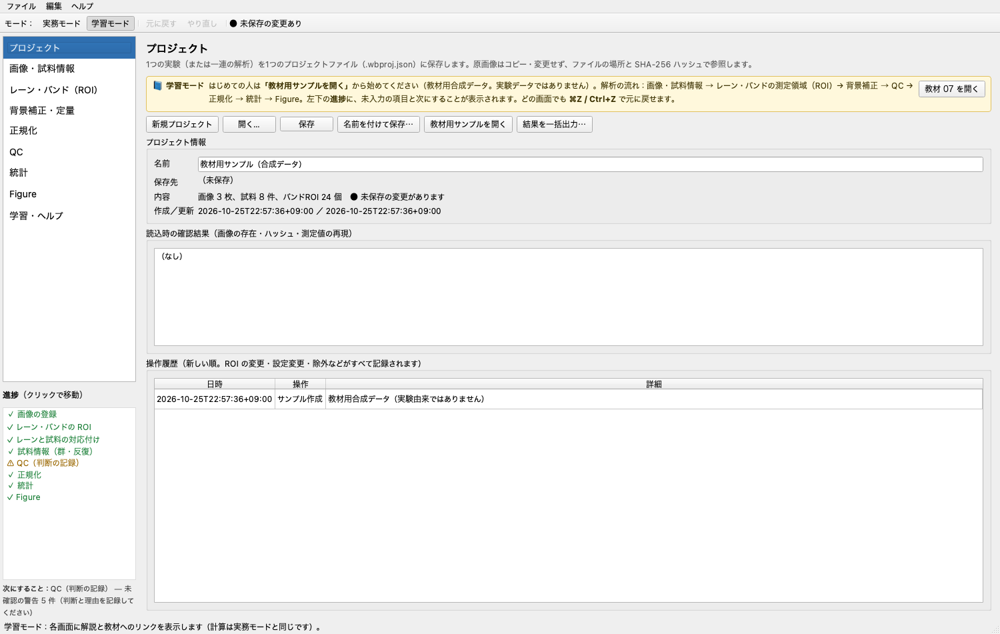
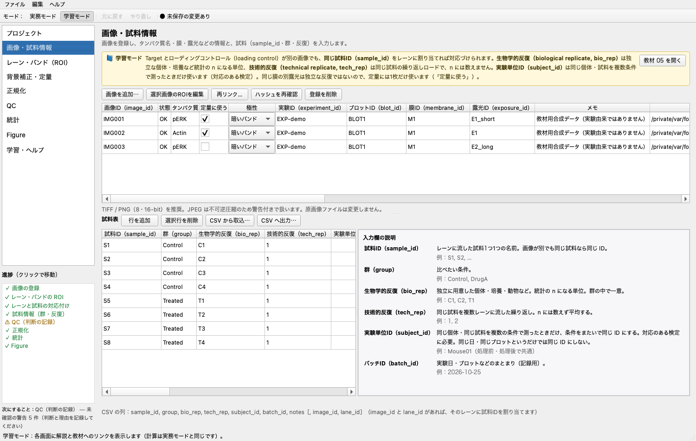
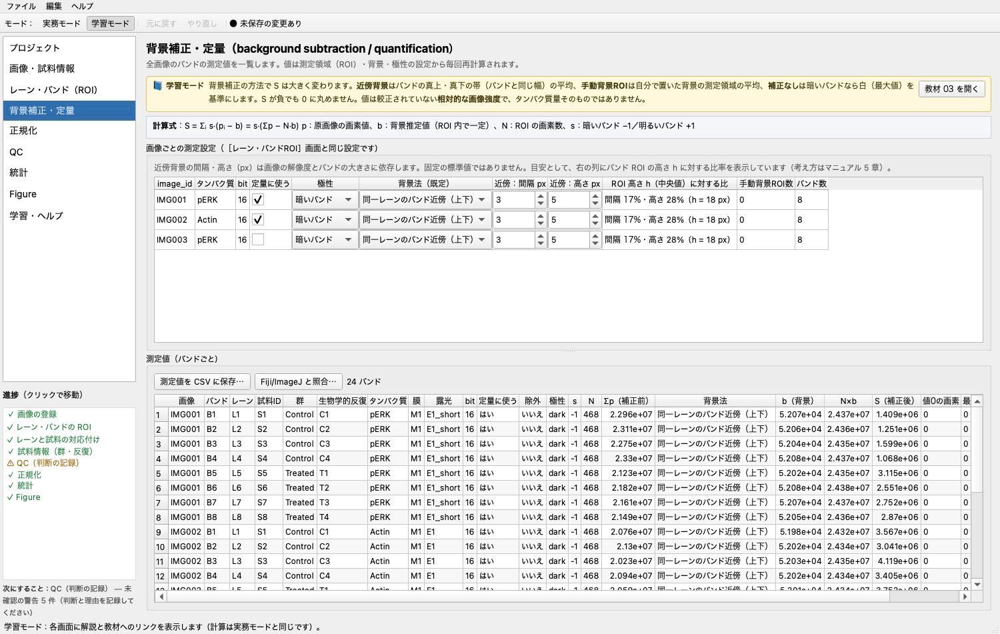
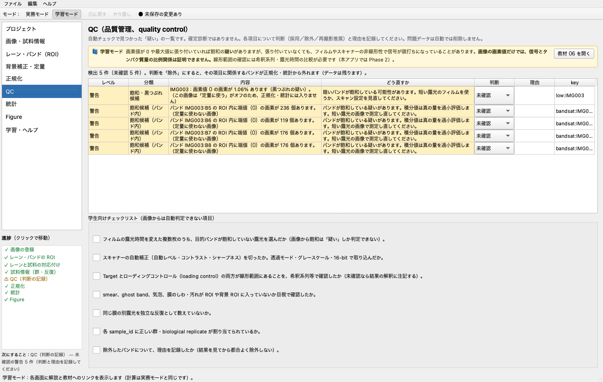
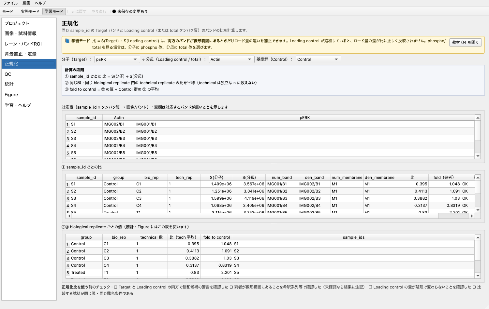
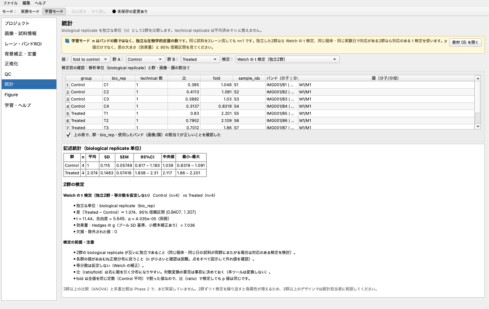
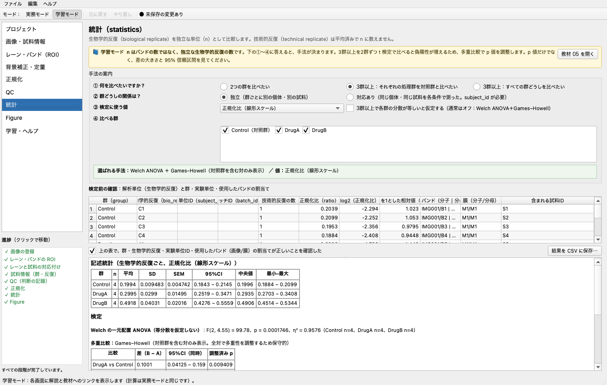
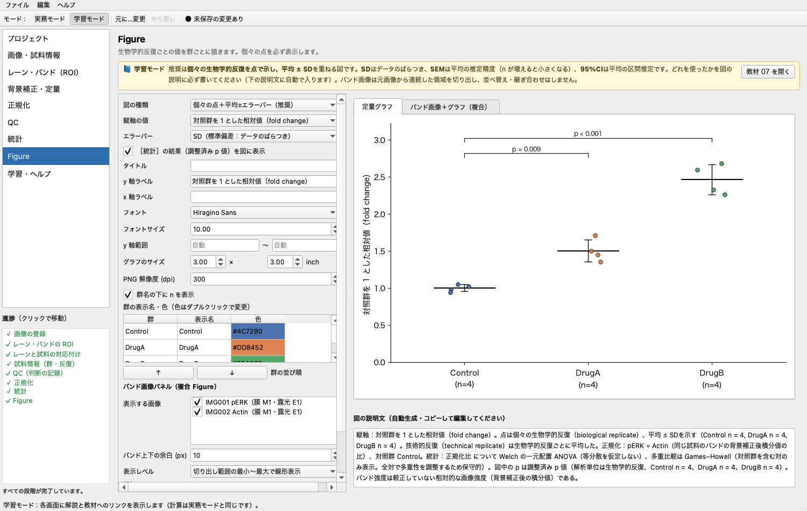
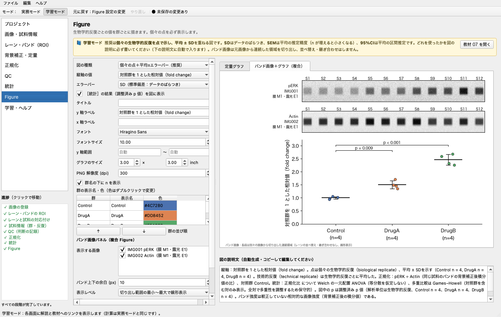

# 操作マニュアル（学生向け）

このマニュアルだけで、画像の読み込みから Figure の保存までを一人で進められるように書いています。
アプリの中でも［学習・ヘルプ］→「マニュアル・資料」で同じ内容を読めます。

> 本アプリの測定値は、**較正されていない相対的な画像強度**です。光学密度やタンパク質の絶対量ではありません。
> 画像からは飽和の「疑い」は分かりますが、信号がタンパク質量に比例しているか（線形範囲にあるか）は証明できません。

このマニュアルで使う主な用語（画面の表記に合わせています）：

| 用語 | 意味 |
|---|---|
| 測定領域（ROI） | 画素値を合計する矩形の範囲。ROI は region of interest の略 |
| 背景補正（background subtraction） | バンドの外の「土台」の明るさ b を推定して差し引くこと |
| ローディングコントロール（loading control） | ロード量の違いを補正するために分母に使うタンパク質（actin など） |
| 生物学的反復（biological replicate） | 独立に用意した個体・培養など。**統計の n になる単位**。試料表の `bio_rep` |
| 技術的反復（technical replicate） | 同じ試料を複数レーンに流した繰り返し。n には数えず平均する。試料表の `tech_rep` |
| 対照群を1とした相対値（fold change） | 対照群の平均で割った値。画面や CSV では `fold` |
| 実験単位ID（subject_id） | 同じ個体・同じ試料を複数の条件で測ったときに、条件をまたいで共通にする ID |

---

## 0. 最短手順（教材用サンプルで 10 分）

1. アプリを起動する（README の「起動方法」を参照）。
2. ［プロジェクト］→ **「教材用サンプルを開く」**。2群か3群かを選び、画像を書き出すフォルダーを選ぶ。
   - **2群**：Control / Treated、過露光（飽和）の例つき。t 検定の練習用。
   - **3群**：Control / DrugA / DrugB、各群 4 生物学的反復。多重比較の練習用。
   - どちらも**教材用合成データ（実験由来ではありません）**で、ROI 設定済みのプロジェクトができます。
3. ［レーン・バンドROI］で赤いバンド ROI を1つドラッグし、右下の **S の値がリアルタイムに変わる**ことを確かめる。
   ⌘Z（macOS）で元に戻す。
4. ［QC］で警告を読む（2群サンプルでは IMG003（長い露光）が飽和候補として出ます）。判断と理由を記録する。
5. ［正規化］で、分子 pERK ÷ 分母 Actin、対照群 Control が選ばれていることを確かめる。
6. ［統計］で ①〜④ の質問に答え、割当て表を確認してチェックを入れ、結果を読む。
7. ［Figure］で図を整え、必要なら p 値を表示して PNG / SVG / PDF を保存する。図の説明文もコピーする。
8. ［プロジェクト］→「結果を一括出力」で、測定 CSV・設定 JSON・ROI 一覧・ROI 重ね合わせ画像・統計結果・図・図の説明文をまとめて保存する。

左下の**進捗**パネルを見れば、次に何をすればよいかが分かります（第 1 章）。

---

## 1. 画面の構成

- **左のサイドバー**：上から順に進めると解析が完了します。
  プロジェクト → 画像・試料情報 → レーン・バンド（ROI） → 背景補正・定量 → 正規化 → QC → 統計 → Figure → 学習・ヘルプ
- **進捗パネル（サイドバーの下）**：解析の各段階の状態を記号で示します。
  - 段階：画像の登録／レーン・バンドの ROI／レーンと試料の対応付け／試料情報（群・反復）／QC（判断の記録）／正規化／統計／Figure
  - 記号：✓ 完了、⚠ 確認が必要（例：未判断の QC 警告、膜ID の未入力）、・ 未完了、✗ 先に進めない理由がある（例：QC のエラー、8-bit と 16-bit の混在）
  - 項目にマウスを重ねると、未入力の項目や解析できない理由が出ます。**クリックするとその画面に移動**します。
  - 一番下の「次にすること」に、最初に片づけるべき項目が表示されます。
- **上のツールバー**
  - **実務モード／学習モード**：学習モードでは各画面に黄色の解説と「教材を開く」ボタンが出ます。計算はどちらも同じです。
  - **元に戻す／やり直し**：ROI の移動・設定変更・除外など、プロジェクトの内容を変える操作はすべて元に戻せます。
- **操作履歴**：すべての変更は日時つきで［プロジェクト］の履歴に残り、元に戻した操作も記録されます。

---

## 2. プロジェクトを作る・保存する

| 操作 | 場所 |
|---|---|
| 新規作成 | ［プロジェクト］「新規プロジェクト」、またはメニュー［ファイル］ |
| 保存 | 「保存」（⌘S）。初回は保存先を聞かれます。拡張子は `.wbproj.json` |
| 開く | 「開く…」（⌘O） |

- 原画像は**コピーも変更もしません**。プロジェクトファイルには、画像の場所と **SHA-256 ハッシュ**（ファイルの指紋）を記録します。
- 開くときに次の3点を自動で確認し、結果を「読込時の確認結果」に表示します。
  1. 画像ファイルがあるか（無ければ再リンクを促します）
  2. 画像の内容が登録時と同じか（ハッシュの比較）
  3. 保存時の測定値と、開いた後に再計算した値が一致するか
- プロジェクトファイルと画像を**同じフォルダーごと**移動した場合は、相対パスで自動的に見つけます。

---

## 3. 画像と試料情報を登録する

### 3.1 画像を追加する
1. 「画像を追加…」で TIFF / PNG を選ぶ（複数選択可）。JPEG は不可逆圧縮のため警告が出ます。
2. 表で次の項目を入力する（ダブルクリックで編集）。

| 項目 | 入力の例 | 意味 |
|---|---|---|
| タンパク質 | pERK、Actin | この画像で測るタンパク質。正規化の分子・分母の選択肢になります。1枚の画像に複数のタンパク質がある場合は、バンドごとに変えられます（4.6 節） |
| 定量に使う | ✓ | 同じ膜の別露光が複数あるときは、**飽和していない1枚だけ** ✓ |
| 極性 | 暗いバンド | フィルムのスキャン像は通常「暗いバンド」 |
| 膜ID（membrane_id） | M1 | 膜の ID。同じ膜を再プローブしたなら同じ ID |
| 露光ID（exposure_id） | E1_30s | 露光の ID（露光時間など） |
| 実験ID・ブロットID（experiment_id / blot_id） | EXP-2026-10-01 | 実験・ブロットの識別子 |

- 「サイズ」「bit」「SHA-256」「登録日時」は自動で記録され、編集できません。
- 16-bit の画像は 16-bit のまま測定します（8-bit に縮小しません）。
- **8-bit と 16-bit の画像を混ぜないでください。** 同じタンパク質の値が 8-bit と 16-bit の画像から混在すると、階調のスケールが違うため、統計と Figure を止めます（7.4 節）。

### 3.2 画像が見つからないとき（再リンク）
状態が「ファイルなし」になった画像を選び、「再リンク…」で新しい場所のファイルを選びます。
内容（ハッシュ）が違うファイルを選ぶと確認が出ます。画像サイズが違うファイルにはリンクできません（ROI 座標の意味がなくなるため）。

### 3.3 試料表
画面右の「入力欄の説明」にも同じ説明と入力例が出ます。

| 列 | 意味 | 例 |
|---|---|---|
| 試料ID（sample_id） | レーンに流した試料1つ1つの名前。画像が別でも同じ試料なら同じ ID | S1, S2 |
| 群（group） | 比べたい条件 | Control、DrugA |
| 生物学的反復（bio_rep） | 独立に用意した個体・培養・動物など。**統計の n になる単位**。群の中で一意 | C1、C2、T1 |
| 技術的反復（tech_rep） | 同じ試料を複数レーンに流した繰り返し。n に数えず平均する | 1、2 |
| 実験単位ID（subject_id） | 同じ個体・同じ試料を複数の条件で測ったときだけ、条件をまたいで同じ ID にする。**対応のある検定に必要** | Mouse01（処理前・処理後で共通） |
| バッチID（batch_id） | 実験日・ブロットなどのまとまり（記録用。統計の対応付けには使いません） | 2026-10-25 |

- 同じ試料を2レーン流した場合：sample_id は別々（S1a、S1b）にし、**bio_rep は同じ**、tech_rep を 1・2 にします。
- **対応のある設計**（同じ個体の処理前と処理後など）では、両群で**同じ subject_id** を入力します。
  - 対応は subject_id だけで決まります。**同じ日に測った・同じブロットに載せたというだけでは対応ありにしません**（その情報は batch_id に書きます）。
  - 群ごとに別の個体を使う独立な設計では、subject_id は空欄のままで構いません。
- 「CSV から取込…」で一括入力できます。列名は `sample_id, group, bio_rep, tech_rep, subject_id, batch_id, notes, image_id, lane_id`（`subject_id` 以降は省略可）。
  `image_id` と `lane_id` を書くと、そのレーンに sample_id を割り当てます。Excel では「CSV UTF-8」で保存してください。

---

## 4. レーンとバンドの ROI を設定する

### 4.1 画像の操作
- **拡大縮小**：マウスホイール。**移動**：ドラッグ（ROI の外）。「全体表示」で元に戻ります。
- 右上にマウス位置の座標と**原画像の画素値 p**が出ます。
- **表示**の切替（原画像／反転表示／自動コントラスト）は**見え方だけ**を変えます。**測定値は変わりません。**

### 4.2 バンド極性
フィルムのスキャン像ではバンドは背景より**暗い**（画素値が小さい）ので「暗いバンド」を選びます。
極性は計算式の符号 s（暗い −1、明るい +1）を決めます。間違えると S の符号が逆になります。

### 4.3 レーン
1. 画像を拡大して、バンドのある範囲が画面に入るようにする。
2. 「レーン数」を入れて **「レーン候補を提示」**。表示範囲の列方向プロファイルから候補を出します。
   - 明瞭なピークが見つからないときは等間隔に並べます（メッセージで知らせます）。
   - **候補は必ず目視で確認**し、青い点線の枠をドラッグして合わせます。四隅・辺の◇で大きさを変えられます。
   - レーンを横に動かすと、そのレーンのバンドも一緒に動きます。
3. 「レーンと試料ID」タブで、各レーンに sample_id を選ぶ（新しい ID を入力すると試料表に追加されます）。

### 4.4 バンド ROI
1. レーンをクリックして選び、「選択レーンにバンドを追加」。赤い枠をバンドに合わせる。
2. 大きさと位置が決まったら、そのバンドを選んだまま **「選択バンドを全レーンに複製」**。
3. 大きさが変わってしまったら、基準のバンドを選んで **「ROIサイズを揃える」**（同じタンパク質のバンドが同じ幅・高さになります）。
4. どうしても1つだけ大きさを変えるときは、幅・高さを入れて「選択バンドだけ個別に変更」（履歴に残ります）。
5. 右上のプロファイルでは、赤い帯がバンド ROI の y 範囲、黄色が近傍背景、橙の破線が背景値 b です。
   **赤い帯の端をドラッグすると ROI の上下も変わります。**
6. 不要な ROI は選んで Delete キー（または「選択ROIを削除」）。

### 4.5 右下の式
選択したバンドについて、`S = s × (Σp − N × b)` に実際の数値を入れた式を表示します。
ドラッグ中は「仮の値」と表示され、手を離すと確定して履歴に記録されます。
紫の「参考：プロファイル面積」は定義が違う参考値で、S とは一致しません（`docs/validation_imagej.md` 参照）。

### 4.6 1枚の画像に複数のタンパク質があるとき（タンパク質で絞り込み）
分子量の違う2つのタンパク質を同じ膜・同じ画像で測る場合などです。
- 「バンドと測定値」タブの「タンパク質」列で、バンドごとにタンパク質名を変えられます（既定は画像のタンパク質名）。
- 表の上の **「表示するタンパク質」** で、一覧をそのタンパク質のバンドだけに絞り込めます。右にタンパク質ごとのバンド数が出ます。
- 「ROIサイズを揃える」「全レーンに複製」は、同じタンパク質のバンドどうしに対して働きます。

---

## 5. 背景補正と定量

| 方法 | 背景値 b の決め方 | 向いている場合 |
|---|---|---|
| 同一レーンのバンド近傍（上下）【既定】 | バンド ROI の真上・真下の帯（バンドと同じ幅、間隔 gap・高さ height、新しい画像の初期値は 3 px と 5 px）の全画素の平均 | 背景がなだらかに変化する通常のブロット |
| 手動背景ROIの平均 | 自分で置いた緑の背景 ROI の全画素の平均（画像内で共通） | 近傍にほかのバンドや汚れがある場合 |
| 背景補正なし | 暗いバンドでは白（8-bit は 255、16-bit は 65535） | 比較・教育用。通常は使わない |

- 画像ごとの既定の方法は［レーン・バンドROI］の「③ 背景」か、この画面の上の表で変えます。
- バンドごとに変えたいときは、バンド表の「背景法」列で選びます。
- **S が負になっても 0 に丸めません**（QC に「負の補正値」として出ます）。
- 測定値の表は「測定値を CSV に保存…」で書き出せます。列の意味：`raw_sum`＝Σp、`bg_value`＝b、`bg_sum`＝N×b、`corrected`＝S。

### 5.1 近傍背景の大きさの考え方（px は固定の標準値ではない）

近傍背景の間隔と高さは **px（画素）単位**で保存されます。しかし、同じバンドでも、スキャン解像度が 2 倍になれば画素数で 2 倍の大きさに写ります。またバンドの太さは実験ごとに違います。したがって **「間隔 3 px・高さ 5 px」は固定の標準値ではなく**、画像の解像度とバンドの大きさに応じて決める必要があります。

そこで本アプリは、バンド ROI の高さ h に対する**比率**でも考えられるようにしています。

- ［背景補正・定量］の上の表に、各画像の「ROI 高さ h（中央値）に対する比」（例：間隔 17%・高さ 28%（h = 18 px））が表示されます。
- ［レーン・バンドROI］の「③ 背景」→「h に対する比」に間隔と高さの比率（初期値は**間隔 30%・高さ 50%**）を入れて「適用」を押すと、その画像のバンド ROI の高さ（中央値）h から px を計算して設定します。設定は元に戻せ、履歴に h と比率が残ります。
- 30%・50% は**目安**であり、正解の値でも研究室の決まりでもありません。gap はバンドの裾を背景に入れないため、height は背景の平均を安定させるための余裕です。
- 比率で設定したあとも、**プロファイル（黄色の帯）と画像を見て、背景帯が隣のバンド・smear・汚れにかかっていないか必ず確認**してください。かかる場合は比率を小さくする、または手動背景 ROI に切り替え、理由を記録します。
- 同じ実験で比べる画像どうしは、同じ考え方（同じ比率など）で背景を取ってください。

### 5.2 Fiji/ImageJ との照合
測定値の表の上にある **「Fiji/ImageJ と照合…」** から、同じ ROI を Fiji で測って本アプリの値と比べられます。手順は第 10 章を見てください。

---

## 6. QC（品質管理）

- 自動チェックの結果は「**疑い**」であり、確定診断ではありません。
- 主なチェック：黒つぶれ・白飛び候補（画像全体で端値が 0.1% 超）、バンド内の端値画素、ROI サイズ不一致、ROI の重なり、画像外へのはみ出し、背景領域とバンドの交差、sample_id の重複割当、同じ膜の複数露光、群・bio_rep の未入力、負の補正値。
- 各項目の「判断」を **採用／除外／再撮影推奨** から選び、「理由」を書きます。
  - 「除外」にすると、その項目に関係するバンドが正規化・統計から外れます。**データ自体は消えません**（元に戻せます）。
- 下の「学生向けチェックリスト」は、画像からは判定できない項目です。確認したらチェックを入れてください（プロジェクトに保存されます）。

---

## 7. 正規化

### 7.1 分子・分母・対照群を選ぶ
画面上部で、分子（Target / phospho）、分母（ローディングコントロール / total）、対照群（control）を選びます。

### 7.2 タンパク質の役割と対応表（「タンパク質と対応表」タブ）
- **タンパク質の役割**：タンパク質ごとに、Target（目的タンパク質）／ローディングコントロール（loading control）／リン酸化体（phospho）／総量（total）／その他・未設定 を選びます。役割を決めると、分子・分母の選択肢がその順に並びます。表には、そのタンパク質のバンド数、画像（膜・露光・bit）、定量に使う画像が出ます。
- **対応表**：試料ID × タンパク質 で、どの画像のどのバンドが使われるかを一覧します。**空欄は対応するバンドが無い**ことを示します。

ローディングコントロールが分子と同じ膜（再プローブ・切り分け）にあるか、別の膜にあるかは、実験によって違います。本アプリはどちらの場合も sample_id で対応付けますが、**分子と分母が別の膜のときは**「対応付けはできるが、膜ごとの転写効率・露光の違いは補正されないため、正規化として適切とは限らない」と警告します。

### 7.3 計算の段階
画面にも同じ順序で表示されます。

- ① sample_id ごとに 比 = S(分子) ÷ S(分母)
- ② 同じ群・同じ生物学的反復（bio_rep）内の技術的反復の比を算術平均（技術的反復は独立な n に数えない）
- ③ 対照群を 1 とした相対値 fold = ② の比 ÷ 対照群の ② の平均（表示用）
- ④ log2 を選んだ場合：`log2_ratio = log2(② の比)`（正の値のみ）。`log2_fold = log2_ratio − 対照群の log2_ratio の平均`、`fold_geo = 2^log2_fold`（対照群の幾何平均を 1 とした相対値）

④ は常に計算して表に出しますが、検定に使うかどうかは［統計］で選びます（既定は線形スケールの比）。比が 0 以下・欠損の生物学的反復は**log2 変換しません**（擬似値で置き換えません）。理由は `log2_status` 列に出ます。

### 7.4 表の読み方と、止まる場合
- 「① 試料IDごとの比（追跡情報つき）」タブ：分子・分母それぞれの**画像/バンド・膜・露光・bit 深度**が出ます。計算できなかった試料は赤、注意がある試料は黄色で表示し、「状態」「注意」列に理由が出ます（分母が 0 以下、分子の S が無効（背景を推定できない・ROI が画像外）、バンドが無い、重複割当、別の膜など）。**0 で割ることはしません。**
- 「②③④ 生物学的反復ごとの値」タブ：統計と Figure に使う表です。
- 画面上部の赤字（⛔）は**統計と Figure を止める問題**です。現在は、**同じタンパク質の値が 8-bit と 16-bit の画像から混在している場合**に止まります。同じ bit 深度で取り込んだ画像だけを「定量に使う」にしてください。
  - 分子がすべて 16-bit、分母がすべて 8-bit のように、試料全体で組み合わせが同じ場合は止まりませんが、「比の絶対値は階調スケールに依存する」という注意が出ます。
- 橙色の ⚠ は注意です（sample_id 未割当、bio_rep 未入力、分子が複数の膜にまたがる、など）。膜間正規化は未実装です。

---

## 8. 統計

### 8.1 ①〜④ に答えて手法を決める

| 質問 | 選択肢 |
|---|---|
| ① 何を比べたいですか？ | 2つの群を比べたい／3群以上：それぞれの処理群を対照群と比べたい／3群以上：すべての群どうしを比べたい |
| ② 群どうしの関係は？ | 独立（群ごとに別の個体・別の試料）／対応あり（同じ個体・同じ試料を各条件で測った。subject_id が必要） |
| ③ 検定に使う値 | 正規化比（線形スケール）／log2（正規化比）。3群以上では「各群の分散が等しいと仮定する」チェック（通常はオフ） |
| ④ 比べる群 | 2群なら群 A・群 B、3群以上なら比較に含める群にチェック |

答えに応じて、次の手法が選ばれ、緑の枠に表示されます。

| ① 比べたいもの | ② 関係 | 分散の仮定 | 選ばれる手法 |
|---|---|---|---|
| 2群 | 独立 | （仮定しない） | Welch の t 検定 |
| 2群 | 対応あり | — | 対応のある t 検定（subject_id で対応づけ） |
| 3群以上・対照群と比較 | 独立 | 等分散を仮定しない（既定） | Welch ANOVA ＋ Games–Howell（対照群を含む対のみ表示） |
| 3群以上・対照群と比較 | 独立 | 等分散を仮定する | 一元配置 ANOVA ＋ Dunnett |
| 3群以上・全群間 | 独立 | 等分散を仮定しない（既定） | Welch ANOVA ＋ Games–Howell |
| 3群以上・全群間 | 独立 | 等分散を仮定する | 一元配置 ANOVA ＋ Tukey（Tukey–Kramer） |
| 3群以上 | 対応あり | — | **未実装のため検定しません**（反復測定 ANOVA・混合モデルは未実装） |

- 3群以上を2群ずつ t 検定で比べると偽陽性が増えるので、多重比較で p 値を調整します（理由と式は `docs/theory_ja.md` 第 6 章）。
- 「対照群と比較」で等分散を仮定しない場合、Games–Howell は**全ての対について多重性を調整したうえで、対照群を含む対だけを表示**します。調整が対照群との対だけの場合より厳しいので、**保守的**（p 値が大きめ）です。
- ③ で「対照群を1とした相対値（fold）」を検定に選ぶ必要はありません。fold は比を定数で割っただけなので、検定結果（p 値）は比と同じです。
- **log2（正規化比）**は、比が右に裾を引く・倍率で効く変化を扱いたいときの選択肢です。**データを見る前に**どちらを使うか決めてください。log2 を選ぶと、差 d は log2 スケールの差で、`2^d` が群間の幾何平均の比として併記されます。0 以下・欠損の比がある場合は検定しません。

### 8.2 検定前の確認と結果
1. 「検定前の確認」の表で、群・生物学的反復・実験単位ID（subject_id）・バッチID・使用バンド（分子 | 分母）・膜（分子/分母）を確認し、**チェックを入れると**結果が出ます。
2. 記述統計：各群の n、平均、SD、SEM、95%CI、中央値、最小–最大。
3. 2群の結果：差（B − A）とその 95% 信頼区間、t・自由度・p（両側）、効果量（Welch は Hedges の g、対応 t は d_z）、欠損・除外された値の数。
4. 3群以上の結果：全体検定の F（自由度）、p、η²（イータ二乗）と各群の n、多重比較の表（差（B − A）、同時 95%CI、**調整済み p**）。
5. 「検定の前提・注意」と「図の説明文に使う記述」も表示されます。比を計算できず解析に入らなかった試料があれば、その試料ID と理由が注意の先頭に出て、欠損・除外の数にも含まれます。
6. 「結果を CSV に保存…」で `stats_results.csv` を保存できます（比較ごとに 1 行。調整済み p、全体検定の F・p、n、前提・注意を含む）。

### 8.3 検定しない場合
次の場合は理由を表示して**検定しません**。試料表や設定を直してください。
- bio_rep が未入力、または同じ群に同じ bio_rep が重複している。
- 各群の生物学的反復が 2 未満。
- 対応のある 2群で subject_id が未入力、または同じ群の中で subject_id が重複している。
- 3群以上の独立群の比較で、同じ subject_id が複数の群にある（反復測定のデザインのため）。
- 3群以上で「対応あり」を選んだ。
- log2 を選び、0 以下・欠損の比がある。
- 正規化が 8-bit と 16-bit の混在で止まっている。

独立な2群で両群に同じ subject_id がある場合は、検定はしますが「対応のある t 検定が適切かもしれない」と注意が出ます。

---

## 9. Figure

### 9.1 定量グラフ
- 図の種類：個々の点＋平均±エラーバー（推奨・既定）、棒（平均）＋エラーバー＋個々の点、箱ひげ図＋個々の点。どれも**生物学的反復を点で**示します。
- 縦軸の値：対照群を 1 とした相対値（fold change）、正規化比、log2（正規化比）、log2（fold change、対照群の幾何平均 = 0）、対照群の幾何平均を 1 とした相対値。log2 の値では 0 の位置に破線を引きます。
- **エラーバー**：SD（既定）／SEM／95% 信頼区間 から選びます。
  - SD（標準偏差）：データのばらつき。
  - SEM（標準誤差）：平均の推定精度。n が増えると小さくなります。
  - 95% 信頼区間：平均の区間推定（`t(0.975, n−1) × SEM`）。
  - どれを使ったかを必ず図の説明に書きます（説明文に自動で入ります）。違いは教材 07 と `docs/theory_ja.md` 第 7 章。
- **［統計］の結果（調整済み p 値）を図に表示**：チェックすると、［統計］で選んだ手法の p 値を群の間の線とともに表示します。p < 0.001 は「p < 0.001」、それ以外は小数 3 桁で表示します（アスタリスクは使いません）。3群以上では調整済み p です。
  - 図の縦軸と検定に使った値のスケール（線形／log2）が違うときは警告が出ます。説明文には検定に使った値が書かれます。
  - ［統計］で検定できない設定のときは、理由が表示され p 値は描きません。
- タイトル・軸ラベル・フォント・サイズ・y 軸範囲・図の大きさ・解像度・群の表示名・色（ダブルクリック）・並び順を変えられます。設定はプロジェクトに保存されます。

### 9.2 図の説明文（自動生成）
右下に、論文の Figure legend の下書きとなる説明文が出ます。内容は、縦軸の値、点が生物学的反復であること、エラーバーの種類（または箱ひげ図の中央値と四分位範囲）、各群の n、技術的反復を平均したこと、正規化（分子 ÷ 分母、対照群）、p 値を表示している場合は統計の手法と解析単位、較正していない相対的な画像強度であることです。**コピーして、必要に応じて編集**してください。

### 9.3 バンド画像＋グラフ（複合 Figure）

「バンド画像＋グラフ（複合）」タブで、バンド画像のパネルと定量グラフを 1 枚にまとめます。

- 「表示する画像」で使う画像を選びます（Target を上、ローディングコントロール・total を下に並べます）。
- 各画像から、レーン全体とバンドの縦範囲（上下に「余白」px を加えた範囲）の**連続した矩形**だけを切り出します。**レーンの並べ替えや継ぎ合わせはしません。**
- **画像ごとに別の段**にし、各段にタンパク質・画像ID・膜・露光を表示します（別の画像・別の膜の境界を隠しません）。レーンの上には試料IDが出ます。
- 表示レベルは「切り出し範囲の最小〜最大」または「原画像の全範囲（0〜最大値）」の**線形表示のみ**です（ガンマ補正や部分的な明るさ調整はしません）。
- 「測定領域（ROI）の枠を重ねる」で、測定に使った ROI を赤枠で重ねられます。
- 原画像ファイルは変更しません。

### 9.4 保存
- 「PNG / SVG / PDF を保存…」：表示中のタブの図を保存します（正規化が 8-bit と 16-bit の混在などで止まっているときは保存しません）。複合 Figure を保存すると、同じ場所に次も保存されます。
  - `＜名前＞_bands.json`：各段の画像ID・SHA-256・切り出し座標（原画像の画素）・表示レベル・レーン位置・ROI・表示変換（線形）の記録
  - `＜名前＞_crop_＜画像ID＞.tif`：切り出した画素を**元の値のまま**保存した TIFF
- 「図のデータ・説明文・設定を保存（CSV/JSON/TXT）…」：`figure_data.csv`（生物学的反復ごとの値）、`figure_data_stats.csv`（検定できる場合）、`figure_data_caption.txt`（説明文）、`figure_data.json`（図の設定・正規化の段階・対照群の平均・統計の手法と注意・説明文）を保存します（ファイル名は保存時に付けた名前に合わせて変わります）。

---

## 10. Fiji/ImageJ と照合する

本アプリの測定が、Fiji/ImageJ の Measure と**同じ定義で同じ値になるか**を確かめる機能です。
［背景補正・定量］→「Fiji/ImageJ と照合…」でダイアログを開きます。

1. **画像を選び「① マクロを保存…」**：同じ ROI（バンド・近傍背景の上下の帯・手動背景 ROI）を Fiji で測る ImageJ マクロ（`.ijm`）を保存します。マクロは画像を開き、空間較正を外し（単位を pixel に）、Area・Mean・Min/Max・Integrated density を小数 6 桁で測り、各行に ROI の名前（`wbtool_id`）を付けて、結果をマクロと同じフォルダーの `fiji_results_＜画像ID＞.csv` に保存します。
2. **Fiji で実行**：Fiji で画像を開かずに Plugins › Macros › Run… でマクロを実行します。画像に Edit › Invert や 8-bit 変換などの処理をしないでください（表示の LUT や明るさ調整は画素値を変えないので問題ありません）。
3. **「③ Fiji の結果 CSV を読み込む…」**：Fiji が保存した CSV を選ぶと、3 つのタブで比較します。一致しない行は赤く表示します。
   - **ROI ごと**：面積（Area）、平均（Mean）、画素値の総和（RawIntDen）を本アプリの値と比較し、「判定・原因の候補」を表示します。
   - **バンドごとの b と S**：Fiji の値から同じ式（b は背景帯の Σ RawIntDen ÷ Σ Area、`S = s × (RawIntDen − Area × b)`）で再計算した値と比較します。
   - **正規化比・fold**：読み込んだ画像の値だけを Fiji 由来に置き換えて正規化をやり直し、本アプリの比・fold と比較します。
4. 「照合結果を Markdown で保存…」で、結果を記録用のファイル（`fiji_validation.md`）に保存します。照合の操作は履歴にも残ります。

「判定・原因の候補」に出る主な診断：
- 面積が違う → ROI の位置・大きさが一致していない（Fiji で ROI を動かした、画像が違うなど）
- 平均が「最大値 − 本アプリの平均」になっている → Fiji で Edit › Invert をした可能性
- Fiji の値が 0–255 に収まっている（16-bit 画像） → Fiji で 8-bit に変換した可能性
- 値がおよそ 257 倍（8-bit 画像） → Fiji で 16-bit に変換した可能性
- それ以外 → 別の画像ファイル、Fiji 側での画像処理、カラー変換の違いなど
- 本アプリ・Fiji とも背景値を計算できない（手動背景 ROI が無いなど） → 照合の対象外として扱う

比較には空間較正の影響を受けない RawIntDen を使います（IntDen は使いません）。画像の外にある手動背景 ROI は、本アプリの計算でも除外されるため、マクロにも出力しません。

合格の条件は「**同じ演算定義で同じ値になること**」です。Gel Analyzer のピーク面積は定義が違うので比較しません。詳しくは `docs/validation_imagej.md` を見てください。

---

## 11. 結果をまとめて残す

［プロジェクト］または［ファイル］→「結果を一括出力…」で、選んだフォルダーに次のファイルを書き出します。

| ファイル | 内容 |
|---|---|
| measurements.csv | バンドごとの測定値（Σp、b、N×b、S、背景法、背景領域の座標、警告） |
| roi_list.csv | レーン・バンド・手動背景 ROI の座標（原画像の画素） |
| settings.json | アプリのバージョン、計算式、画像のパス・ハッシュ・bit depth、背景法とパラメータ、正規化の設定とタンパク質の役割、統計の設定（比べたいもの・独立／対応あり・分散の仮定・検定に使う値・比べる群）、図の設定、QC 判断 |
| samples.csv | 試料表（subject_id・batch_id を含む）とレーン割当 |
| normalized_by_sample.csv / normalized_by_biorep.csv | 正規化の①の表と、②③④の表（log2_ratio・log2_fold・fold_geo・log2_status を含む） |
| history.csv | 操作履歴 |
| overlay_IMG***.png | ROI を重ねた表示用画像（自動コントラストは表示用コピーにだけ適用） |
| stats_results.csv | ［統計］の設定で検定できる場合の結果（比較ごとに 1 行、調整済み p、前提・注意） |
| figure.png / .svg / .pdf | 現在の定量グラフ（複合 Figure ではありません） |
| figure_caption.txt | 図の説明文 |

- 正規化が 8-bit と 16-bit の混在で止まっているときは、図と説明文は出力されません。統計の設定で検定できないときは、`stats_results.csv` は出力されません。
- 複合 Figure とその記録ファイルは、［Figure］の「バンド画像＋グラフ（複合）」タブから保存してください（9.4 節）。

原画像・プロジェクトファイル・この出力フォルダーをセットで保管してください。

---

## 12. 困ったとき（よくある間違い）

| 症状 | 原因 | 直し方 |
|---|---|---|
| S が負になる | 極性が逆、または背景 ROI がバンドより暗い場所にある | 極性を確認。背景の位置・方法を見直す |
| 反転表示にしたら値が変わると思った | 表示は測定に影響しません | 正しい動作です。符号を変えたいなら極性を変更 |
| 比が計算されない | 分子か分母のバンドが無い、sample_id の割当て漏れ・重複、分母 ≤ 0 | ［正規化］の「状態」列と対応表を見る |
| 統計が出ない | 確認チェックが無い／bio_rep 未入力／各群の n が 2 未満 | 割当て表を確認してチェック、試料表を修正 |
| 「統計と Figure を止めています」と出る | 同じタンパク質の値が 8-bit と 16-bit の画像から混在 | 同じ bit 深度の画像だけを「定量に使う」にする |
| 対応のある検定ができない | subject_id が未入力・重複 | 同じ個体・試料を両条件で測った場合だけ、両群で同じ subject_id を入れる |
| 3群以上で「対応あり」が検定されない | 反復測定の解析は未実装 | 実験デザインを確認する。独立群として解析してよい設計かどうかを先に判断する |
| log2 で検定できない | 比が 0 以下・欠損の生物学的反復がある | 比（線形）で解析するか、該当バンドの測定（背景・極性）を見直す |
| n が思ったより少ない | 技術的反復は平均されて1つになる | 正しい動作です（独立な n は bio_rep の数） |
| 「露光の重複」警告 | 同じ膜の別露光が両方「定量に使う」 | 飽和していない1枚だけにチェック |
| 画像が見つからない | ファイルを移動・改名した | ［画像・試料情報］で再リンク |
| fold が「—」 | 対照群が未選択、または対照群に有効な値が無い | ［正規化］で対照群を選ぶ |
| 近傍背景の帯が隣のバンドにかかる | 間隔・高さが画像の解像度・バンドの大きさに合っていない | 5.1 節のとおり比率で設定し直し、目で確認する。または手動背景 ROI |
| Fiji と値が合わない | ROI・画像・画素値の処理が違う | 照合ダイアログの「判定・原因の候補」を見る（第 10 章） |

さらに詳しい理論は［学習・ヘルプ］の教材 01〜07 と `docs/theory_ja.md`、スキャンの推奨設定は `docs/protocol_ja.md` を読んでください。
