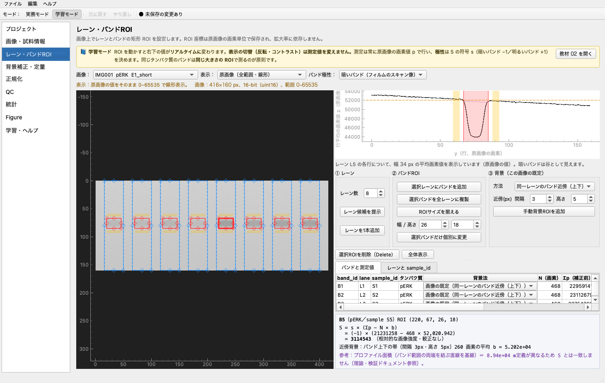
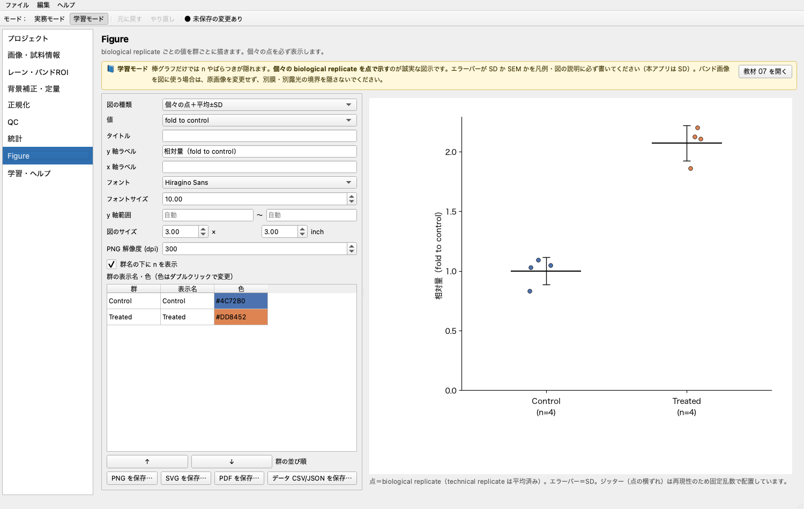

# 操作マニュアル（学生向け）

このマニュアルだけで、画像の読み込みから Figure の保存までを一人で進められるように書いています。
アプリの中でも［学習・ヘルプ］→「マニュアル・資料」で同じ内容を読めます。

> 本アプリの測定値は、**較正されていない相対的な画像強度**です。光学密度やタンパク質の絶対量ではありません。
> 画像からは飽和の「疑い」は分かりますが、信号がタンパク質量に比例しているか（線形範囲にあるか）は証明できません。

---

## 0. 最短手順（教材用サンプルで 10 分）

1. アプリを起動する（README の「起動方法」を参照）。
2. ［プロジェクト］→ **「教材用サンプルを開く」**。画像を書き出すフォルダーを選ぶ。
   - 教材用合成データ（実験由来ではありません）で、ROI 設定済みのプロジェクトができます。
3. ［レーン・バンドROI］で赤いバンド ROI を1つドラッグし、右下の **S の値がリアルタイムに変わる**ことを確かめる。
   ⌘Z（Windows は Ctrl+Z）で元に戻す。
4. ［QC］で警告を読み、IMG003（長い露光）が飽和候補として出ていることを確かめる。
5. ［正規化］で、分子 pERK ÷ 分母 Actin、Control 群が選ばれていることを確かめる。
6. ［統計］で割当て表を確認し、チェックを入れて結果を読む。
7. ［Figure］で図を整えて PNG / SVG / PDF を保存する。
8. ［プロジェクト］→「結果を一括出力」で、測定 CSV・設定 JSON・ROI 一覧・ROI 重ね合わせ画像・図をまとめて保存する。

---

## 1. 画面の構成

- **左のサイドバー**：上から順に進めると解析が完了します。
  プロジェクト → 画像・試料情報 → レーン・バンドROI → 背景補正・定量 → 正規化 → QC → 統計 → Figure → 学習・ヘルプ
- **上のツールバー**
  - **実務モード／学習モード**：学習モードでは各画面に黄色の解説と「教材を開く」ボタンが出ます。計算はどちらも同じです。
  - **元に戻す／やり直し**：ROI の移動・設定変更・除外など、プロジェクトの内容を変える操作はすべて元に戻せます。
- **操作履歴**：すべての変更は日時つきで［プロジェクト］の履歴に残り、元に戻した操作も記録されます。

---

## 2. プロジェクトを作る・保存する

| 操作 | 場所 |
|---|---|
| 新規作成 | ［プロジェクト］「新規プロジェクト」、またはメニュー［ファイル］ |
| 保存 | 「保存」（⌘S）。初回は保存先を聞かれます。拡張子は `.wbproj.json` |
| 開く | 「開く…」（⌘O） |

- 原画像は**コピーも変更もしません**。プロジェクトファイルには、画像の場所と **SHA-256 ハッシュ**（ファイルの指紋）を記録します。
- 開くときに次の3点を自動で確認し、結果を「読込時の確認結果」に表示します。
  1. 画像ファイルがあるか（無ければ再リンクを促します）
  2. 画像の内容が登録時と同じか（ハッシュの比較）
  3. 保存時の測定値と、開いた後に再計算した値が一致するか
- プロジェクトファイルと画像を**同じフォルダーごと**移動した場合は、相対パスで自動的に見つけます。

---

## 3. 画像と試料情報を登録する

### 3.1 画像を追加する
1. 「画像を追加…」で TIFF / PNG を選ぶ（複数選択可）。JPEG は不可逆圧縮のため警告が出ます。
2. 表で次の項目を入力する（ダブルクリックで編集）。

| 項目 | 入力の例 | 意味 |
|---|---|---|
| タンパク質 | pERK、Actin | この画像で測るタンパク質。正規化の分子・分母の選択肢になります |
| 定量に使う | ✓ | 同じ膜の別露光が複数あるときは、**飽和していない1枚だけ** ✓ |
| 極性 | 暗いバンド | フィルムのスキャン像は通常「暗いバンド」 |
| membrane_id | M1 | 膜の ID。同じ膜を再プローブしたなら同じ ID |
| exposure_id | E1_30s | 露光の ID（露光時間など） |
| experiment_id / blot_id | EXP-2026-10-01 | 実験・ブロットの識別子 |

- 「サイズ」「bit」「SHA-256」「登録日時」は自動で記録され、編集できません。
- 16-bit の画像は 16-bit のまま測定します（8-bit に縮小しません）。

### 3.2 画像が見つからないとき（再リンク）
状態が「ファイルなし」になった画像を選び、「再リンク…」で新しい場所のファイルを選びます。
内容（ハッシュ）が違うファイルを選ぶと確認が出ます。画像サイズが違うファイルにはリンクできません（ROI 座標の意味がなくなるため）。

### 3.3 試料表
| 列 | 意味 | 例 |
|---|---|---|
| sample_id | レーンに流した試料の ID（一意） | S1 |
| group | 群 | Control、Treated |
| bio_rep | **biological replicate ID**。独立な個体・培養など、統計の n になる単位 | C1、T1 |
| tech_rep | technical replicate ID。同じ試料を繰り返しロードしたもの（n に数えない） | 1、2 |

- 同じ試料を2レーン流した場合：sample_id は別々（S1a、S1b）にし、**bio_rep は同じ**、tech_rep を 1・2 にします。
- 対応のある設計（同じ個体の処理前後、同じ実験日の Control と処理）では、両群で**同じ bio_rep ID**を使います。
- 「CSV から取込…」で一括入力できます。列名は `sample_id, group, bio_rep, tech_rep, notes, image_id, lane_id`。
  `image_id` と `lane_id` を書くと、そのレーンに sample_id を割り当てます。Excel では「CSV UTF-8」で保存してください。

---

## 4. レーンとバンドの ROI を設定する

### 4.1 画像の操作
- **拡大縮小**：マウスホイール。**移動**：ドラッグ（ROI の外）。「全体表示」で元に戻ります。
- 右上にマウス位置の座標と**原画像の画素値 p**が出ます。
- **表示**の切替（原画像／反転表示／自動コントラスト）は**見え方だけ**を変えます。**測定値は変わりません。**

### 4.2 バンド極性
フィルムのスキャン像ではバンドは背景より**暗い**（画素値が小さい）ので「暗いバンド」を選びます。
極性は計算式の符号 s（暗い −1、明るい +1）を決めます。間違えると S の符号が逆になります。

### 4.3 レーン
1. 画像を拡大して、バンドのある範囲が画面に入るようにする。
2. 「レーン数」を入れて **「レーン候補を提示」**。表示範囲の列方向プロファイルから候補を出します。
   - 明瞭なピークが見つからないときは等間隔に並べます（メッセージで知らせます）。
   - **候補は必ず目視で確認**し、青い点線の枠をドラッグして合わせます。四隅・辺の◇で大きさを変えられます。
   - レーンを横に動かすと、そのレーンのバンドも一緒に動きます。
3. 「レーンと sample_id」タブで、各レーンに sample_id を選ぶ（新しい ID を入力すると試料表に追加されます）。

### 4.4 バンド ROI
1. レーンをクリックして選び、「選択レーンにバンドを追加」。赤い枠をバンドに合わせる。
2. 大きさと位置が決まったら、そのバンドを選んだまま **「選択バンドを全レーンに複製」**。
3. 大きさが変わってしまったら、基準のバンドを選んで **「ROIサイズを揃える」**（同じタンパク質のバンドが同じ幅・高さになります）。
4. どうしても1つだけ大きさを変えるときは、幅・高さを入れて「選択バンドだけ個別に変更」（履歴に残ります）。
5. 右上のプロファイルでは、赤い帯がバンド ROI の y 範囲、黄色が近傍背景、橙の破線が背景値 b です。
   **赤い帯の端をドラッグすると ROI の上下も変わります。**
6. 不要な ROI は選んで Delete キー（または「選択ROIを削除」）。

### 4.5 右下の式
選択したバンドについて、`S = s × (Σp − N × b)` に実際の数値を入れた式を表示します。
ドラッグ中は「仮の値」と表示され、手を離すと確定して履歴に記録されます。
紫の「参考：プロファイル面積」は定義が違う参考値で、S とは一致しません（`docs/validation_imagej.md` 参照）。

---

## 5. 背景補正と定量

| 方法 | 背景値 b の決め方 | 向いている場合 |
|---|---|---|
| 同一レーンのバンド近傍（上下）【既定】 | バンド ROI の真上・真下の帯（バンドと同じ幅、間隔 3 px・高さ 5 px）の全画素の平均 | 背景がなだらかに変化する通常のブロット |
| 手動背景ROIの平均 | 自分で置いた緑の背景 ROI の全画素の平均（画像内で共通） | 近傍にほかのバンドや汚れがある場合 |
| 背景補正なし | 暗いバンドでは白（8-bit は 255、16-bit は 65535） | 比較・教育用。通常は使わない |

- 画像ごとの既定の方法は［レーン・バンドROI］の「③ 背景」か、この画面の上の表で変えます。
- バンドごとに変えたいときは、バンド表の「背景法」列で選びます。
- **S が負になっても 0 に丸めません**（QC に「負の補正値」として出ます）。
- 測定値の表は「測定値を CSV に保存…」で書き出せます。列の意味：`raw_sum`＝Σp、`bg_value`＝b、`bg_sum`＝N×b、`corrected`＝S。

---

## 6. QC（品質管理）

- 自動チェックの結果は「**疑い**」であり、確定診断ではありません。
- 主なチェック：黒つぶれ・白飛び候補（画像全体で端値が 0.1% 超）、バンド内の端値画素、ROI サイズ不一致、ROI の重なり、画像外へのはみ出し、背景領域とバンドの交差、sample_id の重複割当、同じ膜の複数露光、群・bio_rep の未入力、負の補正値。
- 各項目の「判断」を **採用／除外／再撮影推奨** から選び、「理由」を書きます。
  - 「除外」にすると、その項目に関係するバンドが正規化・統計から外れます。**データ自体は消えません**（元に戻せます）。
- 下の「学生向けチェックリスト」は、画像からは判定できない項目です。確認したらチェックを入れてください（プロジェクトに保存されます）。

---

## 7. 正規化

1. 分子（Target）、分母（Loading control または total 体）、基準群（Control）を選ぶ。
2. 計算は次の段階で行い、画面にも表示します。
   - ① sample_id ごとに 比 = S(分子) ÷ S(分母)
   - ② 同じ群・同じ bio_rep の technical replicate の比を平均
   - ③ fold to control = ② の値 ÷ Control 群の ② の平均
3. 「対応表」で、各 sample_id に分子・分母のバンドがそろっているか確認する。
4. 計算できなかった試料は「状態」列に理由が出ます（分母が 0 以下、バンドが無い、重複割当など）。**0 で割ることはしません。**

---

## 8. 統計

1. 値（fold または比）、群 A・群 B、検定を選ぶ。
   - 独立した2群：**Welch の t 検定**
   - 同じ bio_rep ID で対応がある2群：**対応のある t 検定**
   - 3群以上の ANOVA・多重比較などは Phase 2 で未実装のため、選べません。
2. 割当て表（群・bio_rep・使ったバンド・膜）を確認し、チェックを入れると結果が出ます。
3. 結果には、n、平均・SD・95%CI、差とその 95%CI、t・自由度・p、効果量、欠損数、検定の前提と注意が出ます。
4. bio_rep が未入力の試料があると、独立な単位が分からないため**検定しません**。試料表を直してください。

---

## 9. Figure

- 図の種類：個々の点＋平均±SD（既定）、棒＋SD＋点、箱ひげ＋点。どれも biological replicate を点で示します。
- タイトル・軸ラベル・フォント・サイズ・y 軸範囲・図の大きさ・解像度・群の表示名・色（ダブルクリック）・並び順を変えられます。設定はプロジェクトに保存されます。
- 「PNG / SVG / PDF を保存」で図を、「データ CSV/JSON を保存」で図の数値と解析設定を保存します。
- バンド画像を Figure に使う機能（トリミング・パネル配置）は Phase 2 です。現在は「結果を一括出力」の ROI 重ね合わせ画像（表示用コピー）を確認用に使ってください。

---

## 10. 結果をまとめて残す

［プロジェクト］または［ファイル］→「結果を一括出力…」で、選んだフォルダーに次のファイルを書き出します。

| ファイル | 内容 |
|---|---|
| measurements.csv | バンドごとの測定値（Σp、b、N×b、S、背景法、背景領域の座標、警告） |
| roi_list.csv | レーン・バンド・手動背景 ROI の座標（原画像の画素） |
| settings.json | アプリのバージョン、計算式、画像のパス・ハッシュ・bit depth、背景法、正規化・統計・図の設定、QC 判断 |
| samples.csv | 試料表とレーン割当 |
| normalized_by_sample.csv / normalized_by_biorep.csv | 正規化の①と②③の表 |
| history.csv | 操作履歴 |
| overlay_IMG***.png | ROI を重ねた表示用画像（自動コントラストは表示用コピーにだけ適用） |
| figure.png / .svg / .pdf | 現在の Figure |

原画像・プロジェクトファイル・この出力フォルダーをセットで保管してください。

---

## 11. 困ったとき（よくある間違い）

| 症状 | 原因 | 直し方 |
|---|---|---|
| S が負になる | 極性が逆、または背景 ROI がバンドより暗い場所にある | 極性を確認。背景の位置・方法を見直す |
| 反転表示にしたら値が変わると思った | 表示は測定に影響しません | 正しい動作です。符号を変えたいなら極性を変更 |
| 比が計算されない | 分子か分母のバンドが無い、sample_id の割当て漏れ・重複、分母 ≤ 0 | ［正規化］の「状態」列と対応表を見る |
| 統計が出ない | 確認チェックが無い／bio_rep 未入力／各群の n が 2 未満 | 割当て表を確認してチェック、試料表を修正 |
| n が思ったより少ない | technical replicate は平均されて1つになる | 正しい動作です（独立な n は bio_rep の数） |
| 「露光の重複」警告 | 同じ膜の別露光が両方「定量に使う」 | 飽和していない1枚だけにチェック |
| 画像が見つからない | ファイルを移動・改名した | ［画像・試料情報］で再リンク |
| fold が「—」 | Control 群が未選択、または Control に有効な値が無い | ［正規化］で Control 群を選ぶ |

さらに詳しい理論は［学習・ヘルプ］の教材 01〜07 と `docs/theory_ja.md`、スキャンの推奨設定は `docs/protocol_ja.md` を読んでください。
